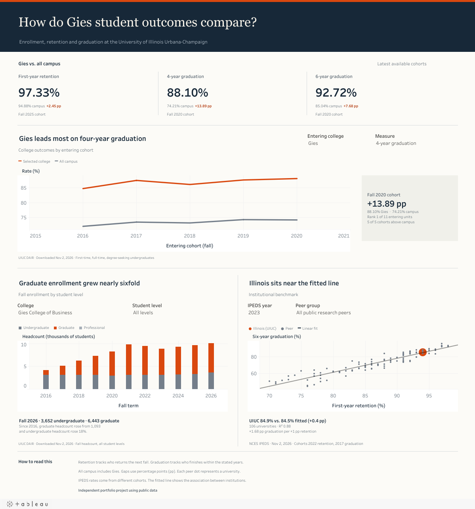

# Gies Retention, Graduation and Enrollment

**Question:** How do Gies retention and graduation compare with all of campus? Across public research universities, how closely is first-year retention associated with six-year graduation?

**Answer:** Gies ranked first of 11 Illinois entering units in four-year graduation for fall 2020 (88.10% vs. 74.21% for all campus). For fall 2025 entrants, Gies's first-year retention was 2.68 percentage points above the rest of campus. In the 2023 IPEDS sample of 106 public research universities, each additional retention point was associated with about 1.7 more points of six-year graduation.

**Dashboard:** [Open the interactive dashboard on Tableau Public](https://public.tableau.com/app/profile/david.lepighe/viz/gies_dashboard/GiesRetentionandGraduation)

**Tableau workbook:** [Download the packaged workbook](dashboard/gies_dashboard.twbx) with the three data extracts included.

**Memo:** [memo/findings.pdf](memo/findings.pdf)

*Independent project using public data. Not affiliated with the Gies College of Business or DAIR.*

## Key numbers

| Measure | Latest cohort | Gies | Comparison group | Comparison rate | Gap (points) |
| --- | --- | --- | --- | --- | --- |
| **First-year retention (z-test)** | Fall 2025 | 97.33% | **Rest of campus, excluding Gies** | 94.65% | **+2.68** |
| First-year retention (dashboard) | Fall 2025 | 97.33% | All campus, including Gies | 94.88% | +2.45 |
| 4-year graduation | Fall 2020 | 88.10% | All campus, including Gies | 74.21% | +13.89 |
| 6-year graduation | Fall 2020 | 92.72% | All campus, including Gies | 85.04% | +7.68 |

[DAIR](https://dair.illinois.edu/access-data/retention-and-graduation-rates/) measures first-year retention at the campus level: the share of first-time, full-time, degree-seeking undergraduates who return to UIUC the next fall, grouped by their college at entry.

- **Two-proportion z-test:** 766 of 787 Gies entrants returned, compared with 7,958 of 8,408 entrants in the rest of campus. The 2.68-point gap has a 95% confidence interval of 1.46 to 3.91 percentage points (z = 3.27, p = 0.0011).
- **Trend vs. all campus:** the 4-year gap held between 12.7 and 14.0 points over five cohorts, and the 6-year gap between 6.2 and 7.7. The retention gap ranged from 0.2 to 3.1 points with no clear direction.
- **Enrollment:** Gies graduate headcount rose from 1,093 in fall 2016 to 6,443 in fall 2026, almost six times as many. Undergraduate headcount rose 18%, from 3,102 to 3,652. Fall 2026 is the current term as DAIR reported it on Nov 2, 2026.

## Regression

OLS on 2023 IPEDS data, one row per institution. Outcome: six-year graduation rate.

| Model | Slope on retention | 95% CI | p | R² | n |
| --- | --- | --- | --- | --- | --- |
| Model 1: retention only | 1.681 | [1.561, 1.8] | 3.5e-50 | 0.883 | 106 |
| Model 2: retention + log(enrollment) | 1.675 | [1.536, 1.814] | 9.7e-44 | 0.883 | 106 |

UIUC's predicted rate is 84.5% and its actual rate is 84.9%, a residual of +0.4 points (residual SD 4.4), so it sits on the line. Adding enrollment does not change the fit. The slope stays between 1.66 and 1.98 across 2019–2023, and at 1.73 after removing high-influence schools.

**Limits:** this is institution-level and correlational, not causal. Selective schools have high retention and high graduation for shared reasons. With about 100 rows the estimate is rough. Rates come from different cohorts: in the 2023 files, retention follows the fall 2022 entrants and graduation the 2017 entrants.

## Dashboard views

Use the dashboard to compare a college and outcome measure against campus, explore fall enrollment by college and student level, and switch the IPEDS comparison by year and peer group. The peer view starts with the 2023 data for all 106 public research universities. The orange point is the University of Illinois Urbana-Champaign as a whole.

[](https://public.tableau.com/app/profile/david.lepighe/viz/gies_dashboard/GiesRetentionandGraduation)

See the [Tableau workbook guide](dashboard/TABLEAU_GUIDE.md) for the release settings and validation checks.

## Data sources

| Source | URL | Downloaded | Filters | Years covered |
| --- | --- | --- | --- | --- |
| DAIR retention | https://dair.illinois.edu/access-data/retention-and-graduation-rates/ | Nov 2, 2026 | Retention Data Table, Crosstab CSV, default filters, Compare = None | 2021–2025 cohorts |
| DAIR graduation | same page | Nov 2, 2026 | Graduation Rate Data Table, cumulative and non-cumulative sheets, Crosstab CSV, default filters | 2016–2020 cohorts |
| DAIR enrollment | https://dair.illinois.edu/access-data/student-enrollment/ | Nov 2, 2026 | Historical Data, Historical Table, Crosstab CSV, default filters | File covers 1870–2026; used fall 2016–2026 |
| IPEDS | https://nces.ed.gov/ipeds/datacenter/data/ (complete data files HD, EF A, EF D, GR) | Nov 2, 2026 | Public, Carnegie 2021 Basic = 15 (107 schools before blanks) | 2019–2023 collections |

The project uses separate ranges for each source: fall 2021–2025 entering cohorts for DAIR retention, fall 2016–2020 entering cohorts for DAIR graduation, fall 2016–2026 terms for DAIR enrollment, and 2019–2023 collection years for IPEDS. The IPEDS models use 105–106 universities per year, with 106 in 2023. The 2019–2022 IPEDS data uses revised files; the 2023 analysis uses the 2023 collection files available at download.

Full column definitions: [data/clean/README.md](data/clean/README.md).

## How to reproduce

```
pip install -r requirements.txt
python scripts/download_ipeds.py
```

Then run `notebooks/01_clean.ipynb`, `02_trends.ipynb` and `03_regression.ipynb` in order, and `python scripts/build_memo.py` for the PDF. The DAIR CSVs are already in `data/raw/dair/`.
